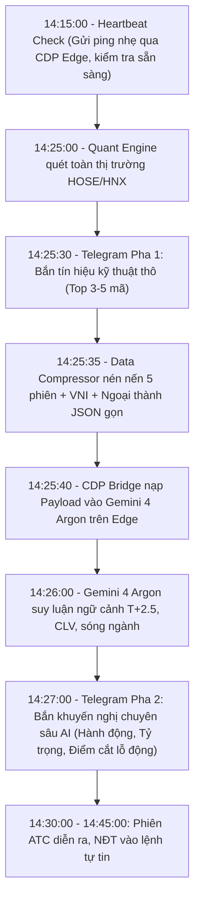

# BLUEPRINT KIẾN TRÚC: HỆ THỐNG HYBRID QUANT-AI (VN-STOCK & GEMINI 4 ARGON PRO)

- **Tài liệu**: `blueprint.md`
- **Vai trò thực hiện**: Chief System Architect & Quantitative Trading Strategist (Gemini 4 Argon Pro)
- **Mục tiêu**: Tối ưu hóa luồng thực thi T+2.5 tại thị trường chứng khoán Việt Nam (HOSE/HNX) với điểm nghẽn thời gian thực (Real-time Bottleneck) tại khung **14:25 – 14:35** (trước khi đóng sổ lệnh ATC).

---

## PHẦN 1: ĐÁNH GIÁ KIẾN TRÚC HYBRID (QUANT ENGINE + WEB CDP BRIDGE)

Kiến trúc tách biệt **Quant Engine (Xử lý thô / Lọc tín hiệu)** và **LLM Reasoning (Đánh giá ngữ cảnh qua CDP Bridge)** là một thiết kế Out-of-the-box cực kỳ thực dụng, giải quyết triệt để bài toán chi phí (**Zero Marginal API Cost**) trong khi vẫn khai thác được năng lực suy luận sâu (**Deep Reasoning**) của mô hình đầu bảng Gemini 4 Argon. Tuy nhiên, việc biến giao diện Web thành một Production API ẩn chứa những rủi ro hệ thống nghiêm trọng cần được rào chắn.

### 1.1. Ưu điểm chiến lược
- **Tối ưu hóa Tỷ lệ Tín hiệu/Nhiễu (Signal-to-Noise Ratio)**: Thay vì ném toàn bộ 1.600 mã cổ phiếu vào LLM (gây ảo giác và tốn thời gian), Quant Engine đóng vai trò màng lọc thô, chỉ chọn ra Top 3–5 mã có xác suất thắng cao nhất để AI "khám sức khỏe" chuyên sâu.
- **Khai thác Context Window lớn miễn phí**: Giao diện Web cho phép duy trì một phiên chat dài (Stateful Session), giúp mô hình nhớ được diễn biến thị trường từ phiên sáng hoặc các ngày trước đó mà không tốn phí nạp lại (Prompt Caching tự nhiên).

### 1.2. Ma trận Rủi ro Kỹ thuật & Giải pháp Khắc phục (Hardening 24/7)

| Loại rủi ro | Mô tả chi tiết & Tác động lúc 14:28 | Giải pháp Kiến trúc (Mitigation Strategy) |
| :--- | :--- | :--- |
| **1. Thay đổi DOM (DOM Mutation)** | Google cập nhật giao diện Web làm gãy các bộ chọn CSS/XPath của ô nhập liệu hoặc nút gửi. Bot bị mù ngay giờ vàng. | Không dùng CSS Selector cứng. Sử dụng định vị qua thuộc tính ngữ nghĩa (`role="textbox"`, `rich-textarea`, `__quill`). Điều khiển bàn phím qua CDP dispatch key event và `Quill.setText`. |
| **2. Độ trễ & Kẹt luồng Streaming** | Lúc 14:30, nếu mạng lag hoặc mô hình suy nghĩ quá 45 giây, bản tin Telegram gửi về lúc 14:44 sẽ khiến NĐT không kịp đặt lệnh ATC. | **Cơ chế Dual-Stage Alert (Cảnh báo 2 pha)**:<br>- **14:26:00 (Pha 1 - Raw Quant)**: Bắn ngay danh sách 3-5 mã từ Python sang Telegram để NĐT chuẩn bị sẵn trên app chứng khoán.<br>- **14:26:05**: Gửi dữ liệu qua CDP.<br>- **14:28:30 (Pha 2 - AI Verdict)**: Đặt Hard Timeout = 60s. Nếu quá 60s chưa stream xong, cắt ngang dữ liệu đang có để NĐT tự quyết dựa trên Pha 1. |
| **3. Hết hạn Session / Re-Auth** | Cookie Google hết hạn hoặc xuất hiện Captcha/2FA sau vài ngày treo máy, làm gián đoạn luồng tự động. | **Persistent User Data Dir & Pre-Flight Check**:<br>- Khởi chạy Edge với cờ `--user-data-dir="f:\AI\MCP\edge_profile"` để lưu cứng Cookie.<br>- Thiết lập **Cronjob 14:15 (Heartbeat Check)**: Bot tự gửi một lệnh ping nhẹ ("Ping: Check status"). Nếu thất bại, lập tức bắn cảnh báo đỏ qua Telegram để con người vào đăng nhập lại trước 14:25. |
| **4. Rò rỉ bộ nhớ (Memory Leak)** | Một tab hội thoại kéo dài nhiều ngày với hàng trăm ngàn token sẽ làm trình duyệt Edge ngốn RAM, gây đơ tab và làm chậm tốc độ phản hồi của LLM. | **Daily Ephemeral Chat (Làm mới phiên mỗi ngày)**: Vào lúc 08:45 sáng mỗi ngày giao dịch, script CDP tự động điều hướng về URL gốc (`https://gemini.google.com/app`) để mở một cuộc hội thoại hoàn toàn mới, giải phóng RAM và làm sạch Context. |
| **5. Bot Detection (Anti-Automation)** | Việc bơm một chuỗi văn bản dài trong 1ms qua JS có thể kích hoạt bộ lọc chống bot của Google. | **Clipboard Paste & Event Simulation**: Dùng `Quill.setText()` với source `"user"` hoặc mô phỏng gõ phím / Paste kèm dispatch sự kiện `keydown Enter` chuẩn W3C. |

### 1.3. Luồng thực thi chuẩn xác theo giây (Timeline 14:15 – 14:35)



---

## PHẦN 2: 5 ĐIỂM CHẠM AI CHIẾN LƯỢC TRƯỚC GIỜ ATC

Thuật toán Python (Rule-based) rất giỏi tính toán ma trận số học (MA, RSI, MACD), nhưng lại "mù ngữ cảnh" trước các hành vi thao túng tâm lý và cấu trúc vi mô của thị trường Việt Nam. Dưới đây là 5 góc nhìn chiến lược mà mô hình suy luận Gemini 4 Argon lấp đầy khoảng trống của code thuần:

### 1. Giải phẫu hành vi giá nội phiên (Intraday Price Action & Bull-Trap Detection)
- **Điểm mù của Code**: Code chỉ thấy `Giá hiện tại > Đỉnh 20 phiên` và `Volume > 1.5x MA20` là báo MUA. Code không phân biệt được một cây nến tăng đặc (Marubozu) giữ giá vững từ sáng với một cây nến bị xả rát tạo râu trên dài (Shooting Star / Upthrust) vào lúc 14:15–14:25.
- **Giá trị của AI**: Bằng cách nạp vào thông số **Close Location Value (CLV)**:
  $$\text{CLV} = \frac{\text{Close} - \text{Low}}{\text{High} - \text{Low}}$$
  AI nhận diện ngay: Nếu Volume nổ 250% nhưng giá tụt lại chỉ còn nằm ở 30-40% biên độ nến (CLV < 0.5), AI phán quyết **"BỎ QUA - Nghi vấn Bull-trap xả hàng giá cao"**, cứu nhà đầu tư khỏi bẫy đu đỉnh ngay trước giờ ATC.

### 2. Giải mã phân kỳ dòng tiền (Khối ngoại / Tự doanh vs Nhỏ lẻ)
- **Điểm mù của Code**: Bộ lọc kỹ thuật thô thường bỏ qua hoặc chỉ cộng trừ cơ học lượng mua/bán ròng của Khối ngoại.
- **Giá trị của AI**: AI đánh giá bản chất hấp thụ:
  - Nếu cổ phiếu vượt đỉnh nhưng Khối ngoại bán ròng chiếm tới 50-60% thanh khoản phiên $\rightarrow$ Lực mua là nhỏ lẻ FOMO hứng bô, xác suất xịt T+2.5 cao.
  - Ngược lại, nếu mã tích lũy nền chặt, Volume vừa phải nhưng Khối ngoại gom ròng liên tục 3-5 phiên bất chấp VN-Index rung lắc $\rightarrow$ AI cộng điểm uy tín về **Smart Money Accumulation**.

### 3. Hiệu ứng Hòn tuyết lăn & Sự đồng thuận Ngành (Sector Synergy)
- **Điểm mù của Code**: Chấm điểm từng mã hoàn toàn độc lập (Isolated Scoring).
- **Giá trị của AI**: Tại Việt Nam, sóng ngành quyết định 70% khả năng chạy tiếp của cổ phiếu sau Breakout.
  - Nếu trong Top 5 mã gửi sang có tới 3 mã thuộc nhóm Chứng khoán (ví dụ: SSI, VCI, HCM cùng nổ), AI nhận diện đây là **"Sóng ngành đồng thuận"** và khuyến nghị dồn tỷ trọng vào mã Leader có biên tăng thanh thoát nhất.
  - Ngược lại, nếu một mã Bất động sản đơn lẻ tự nổ vol trong khi cả ngành đang bị bán đỏ lửa $\rightarrow$ Tín hiệu kéo xả cục bộ, hạn chế mở vị thế.

### 4. Dự phóng Động lượng phiên ATC & Rủi ro T+2.5
- **Điểm mù của Code**: Không có khái niệm về quy tắc giao dịch T+2.5 (mua chiều thứ 2, chiều thứ 4 mới được bán) và áp lực margin cuối tuần.
- **Giá trị của AI**:
  - Nếu hôm nay là **Thứ Năm hoặc Thứ Sáu**, AI tự động nâng ngưỡng an toàn lên cao hơn để bù đắp rủi ro giam vốn qua 2 ngày nghỉ cuối tuần khi tin tức vĩ mô bất ngờ xuất hiện.
  - **Đánh giá trạng thái Cận Trần lúc 14:25**: Nếu mã đã tăng +6.2% đến +6.8%, việc đua lệnh ATC sẽ khiến giá vốn bị đẩy lên mức kịch trần (+7%), làm biên an toàn (Risk/Reward) bị bóp nghẹt. AI khuyên: *"Chỉ rải lệnh LO giá tham chiếu/đỏ nhẹ nếu có nhịp rung lắc, tuyệt đối không đua lệnh MP/ATC bằng mọi giá"*.

### 5. Phân bổ vốn Thích ứng & Kịch bản Cắt lỗ Động (Dynamic Position Sizing)
- **Điểm mù của Code**: Áp dụng mức cắt lỗ cố định (ví dụ: cào bằng -7% cho mọi cổ phiếu).
- **Giá trị của AI**:
  - Dựa vào độ biến động ATR(14) và độ dốc của VN-INDEX so với MA50:
    - Nếu VN-Index đang trong pha Uptrend mạnh (Index > MA20 > MA50): Cắt lỗ theo đáy gần nhất hoặc trailing stop theo EMA20.
    - Nếu VN-Index đang đi ngang rung lắc sát MA50: Khuyến nghị hạ tỷ trọng danh mục xuống 20-30% tài khoản và nâng stoploss chặt chẽ (-4% đến -5%).

---

## PHẦN 3: THIẾT KẾ DATA PIPELINE & ĐỊNH DẠNG PROMPT CHUẨN

### 3.1. Cấu trúc Payload Nén Siêu Gọn (Compressed Data Schema)

Để gửi sang Gemini 4 Argon trong chưa đầy 1 giây mà không làm phình context, dữ liệu từ Python Quant Engine được format theo dạng JSON gọn nhẹ:

```json
{
  "timestamp": "2026-10-17 14:25:00",
  "market_regime": {
    "vnindex": 1285.4,
    "ma50": 1262.1,
    "trend": "BULL_MARKET",
    "day_of_week": "Friday"
  },
  "candidates": [
    {
      "symbol": "FPT",
      "sector": "Cong nghe",
      "price_current": 136.5,
      "change_pct": 3.8,
      "high": 137.2,
      "low": 132.0,
      "clv": 0.865,
      "volume_ratio": 2.1,
      "rsi14": 64.2,
      "macd_hist": 1.45,
      "foreign_net_mil": 45.2,
      "breakout_type": "TURTLE_20D_BREAKOUT",
      "pe": 22.4,
      "roe": 26.8
    },
    {
      "symbol": "SSI",
      "sector": "Chung khoan",
      "price_current": 38.2,
      "change_pct": 5.2,
      "high": 38.5,
      "low": 36.3,
      "clv": 0.863,
      "volume_ratio": 2.8,
      "rsi14": 68.5,
      "macd_hist": 0.92,
      "foreign_net_mil": -12.5,
      "breakout_type": "KUMO_BREAKOUT",
      "pe": 18.2,
      "roe": 14.5
    }
  ]
}
```

### 3.2. Bản mẫu Prompt Template Thực Chiến cho Gemini 4 Argon

```markdown
=== [SYSTEM DIRECTIVE: QUANTITATIVE STRATEGIST (GEMINI 4 ARGON PRO)] ===
Bạn là Giám đốc Chiến lược Giao dịch Định lượng (Chief Quantitative Strategist) am hiểu thị trường chứng khoán Việt Nam (HOSE/HNX, quy tắc T+2.5, phiên ATC 14:30-14:45).

### DỮ LIỆU THỊ TRƯỜNG LÚC 14:25:
{DATA_PAYLOAD_JSON}

### YÊU CẦU PHÂN TÍCH:
1. Đánh giá nhanh Market Regime VN-INDEX và yếu tố ngày trong tuần (T+2.5 rủi ro cuối tuần).
2. Phân tích từng mã:
   - Đánh giá CLV (Hành vi giá nội phiên có bị xả cụt đầu hay giữ giá tốt).
   - Dòng tiền Khối ngoại & Sóng ngành.
   - Nhận định: MUA ATC / CHỜ RUNG LẮC / BỎ QUA.
3. Kế hoạch hành động cụ thể: Giá mua khuyến nghị, Tỷ trọng giải ngân (% NAV), Ngưỡng Cắt lỗ và Mục tiêu chốt lời.
```

### 3.3. Định dạng Output Trả Về cho Telegram Bot (Telegram-Friendly Format)

```markdown
⚡ **[KHUYẾN NGHỊ AI TRƯỚC ATC - 14:28]** ⚡
📊 **Thị trường**: VN-INDEX (1,285.4 > MA50 1,262.1) | Uptrend an toàn.
⚠️ **Cảnh báo T+2.5**: Hôm nay là Thứ Sáu, ưu tiên mã có CLV > 0.8 và dòng tiền tổ chức.

---
🔥 **1. FPT (Công nghệ) - KHUYẾN NGHỊ: MUA ATC**
- **Giá hiện tại**: 136.5 (+3.8%) | Vol: 2.1x MA20
- **Đánh giá AI**: CLV đạt 0.86 (lực mua áp đảo nến đặc), Khối ngoại mua ròng +45.2 tỷ. Phá vỡ đỉnh 20 phiên thuyết phục.
- **Tỷ trọng**: 20% NAV
- **Cắt lỗ động**: 131.0 (-4.0%) | **Target**: 148.0 (+8.4%)

🎯 **2. SSI (Chứng khoán) - KHUYẾN NGHỊ: CHỜ RUNG LẮC (LỆNH LO)**
- **Giá hiện tại**: 38.2 (+5.2%) | Vol: 2.8x MA20
- **Đánh giá AI**: Nổ vol mạnh nhưng đã chạm vùng cản và Khối ngoại bán ròng nhẹ. Đua lệnh ATC dễ gặp rủi ro giá trần.
- **Hành động**: Đặt lệnh LO vùng 37.5 - 37.8, không đua MP giá trần.
---
💡 *Khuyến nghị được AI Gemini 4 Argon tổng hợp lúc 14:28 trước phiên ATC.*
```

---

## PHẦN 4: LỘ TRÌNH TRIỂN KHAI VÀO CODEBASE HIỆN TẠI

1. **Bước 1 (`alert_bot.py`)**: Tích hợp luồng quét lúc 14:25, trích xuất dữ liệu Top 3-5 mã theo định dạng JSON nén.
2. **Bước 2 (`f:\AI\MCP\gemini_argon_bridge.py`)**: Sử dụng phương thức gửi tự động đã kiểm chứng (Quill setText + keydown Enter qua CDP Port 9222).
3. **Bước 3 (Dual-Alert Telegram)**:
   - 14:26: Bắn cảnh báo kỹ thuật sơ bộ (Pha 1).
   - 14:28: Bắn nhận định chiến lược chuyên sâu từ Gemini 4 Argon (Pha 2).
4. **Bước 4 (`app.py` Streamlit)**: Bổ sung tab **"AI Second Opinion"** cho phép người dùng click nút "Hỏi Gemini 4 Argon" ngay trên giao diện dashboard cho bất kỳ cổ phiếu nào.